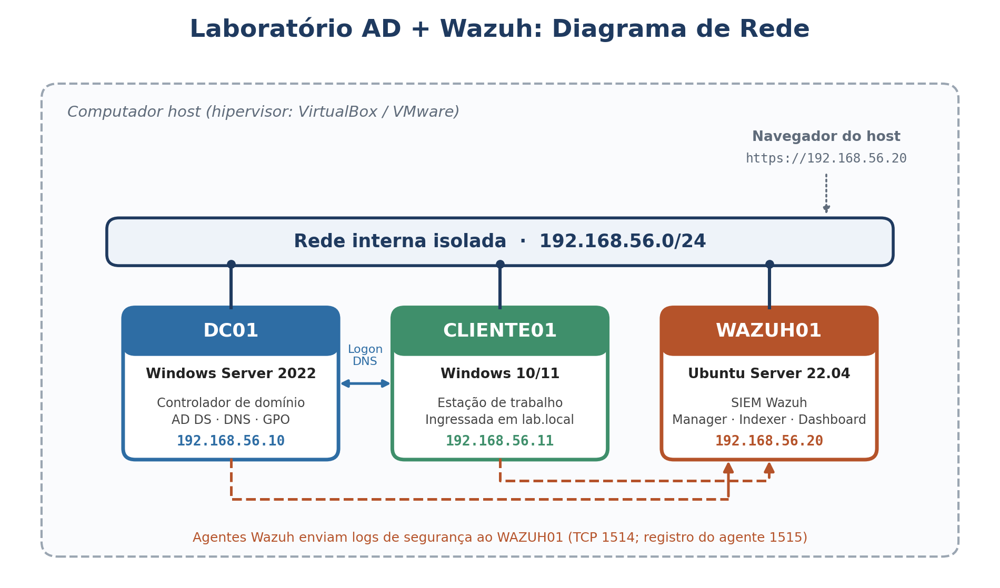

# Laboratório de Segurança: Active Directory + Wazuh (SIEM)

> **EN summary:** A virtualized security lab with a Windows Server 2022 Active Directory domain, a Windows client, and a Wazuh SIEM. I covered the user lifecycle (IAM) and simulated attack scenarios (brute force, account lockout, privilege escalation), documenting the SOC L1 triage of each alert in playbook format.

## Objetivo

Praticar, em ambiente isolado, duas rotinas de segurança da informação:

1. **Gestão de Identidades e Acessos (IAM):** criação, alteração e remoção de acessos no Active Directory.
2. **Monitoramento e triagem de alertas (SOC N1):** coleta de logs com Wazuh e análise de eventos de segurança do Windows.

## Arquitetura

| VM | Sistema | Função | IP |
|---|---|---|---|
| DC01 | Windows Server 2022 | Controlador de domínio (`lab.local`), DNS | 192.168.56.10 |
| CLIENTE01 | Windows 10/11 | Estação de trabalho ingressada no domínio | 192.168.56.11 |
| WAZUH01 | Ubuntu Server 22.04 | Wazuh (manager, indexer, dashboard) | 192.168.56.20 |

> Ajuste a tabela se seus IPs forem diferentes. Todas as VMs ficam em rede interna isolada.

## Ferramentas

Windows Server 2022 · Active Directory DS/DNS · GPO · PowerShell · Ubuntu Server · Wazuh · Sysmon (opcional) · VirtualBox/VMware

## O que foi feito

- [x] Implantação do domínio `lab.local` com estrutura de OUs, grupos e usuários ([docs/02](docs/02-active-directory.md))
- [x] Permissões por grupo em pasta compartilhada (NTFS)
- [x] GPO de política de senha e bloqueio de conta
- [x] Instalação do Wazuh e agentes nas máquinas Windows ([docs/03](docs/03-wazuh.md))
- [x] Auditoria avançada de logon e gerenciamento de contas
- [x] 4 cenários de ataque simulados com ficha de triagem ([docs/04](docs/04-casos-de-uso-soc.md))
- [ ] Integração com Entra ID (próximo passo)

## Casos de uso de SOC

| # | Cenário | Evento Windows | Classificação |
|---|---|---|---|
| 1 | Falhas de logon repetidas (brute force) | 4625 | Suspeito  |
| 2 | Bloqueio de conta | 4740 | Suspeito  |
| 3 | Criação de usuário | 4720 | Benigno (autorizado) |
| 4 | Inclusão em grupo administrativo | 4728 / 4732 | Incidente (escalada de privilégio) |

## Principais aprendizados

- Auditoria é pré-requisito do monitoramento: sem a Advanced Audit Policy ativa no Windows, os eventos de logon não chegavam ao Wazuh. Um SIEM só enxerga o que as fontes registram.
- DNS é a base do AD: o CLIENTE01 só ingressou no domínio depois que apontei o DNS para o DC01.
- 

## Próximos passos

- Integrar o Sysmon e criar regras personalizadas no Wazuh
- Sincronizar o AD local com o Entra ID (Entra Connect)
- Automatizar o ciclo de vida de usuários com PowerShell

## Aviso

Laboratório com fins educacionais, em ambiente isolado. Nenhuma credencial real é publicada neste repositório.

## Autor

**Lucas Alves Barreto** · [LinkedIn](https://linkedin.com/in/lucas-alves-556693206)
