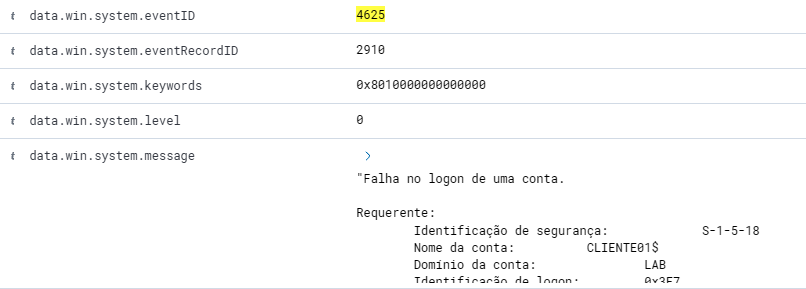
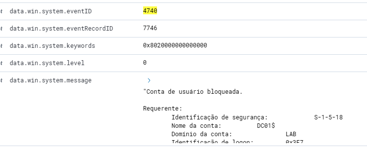
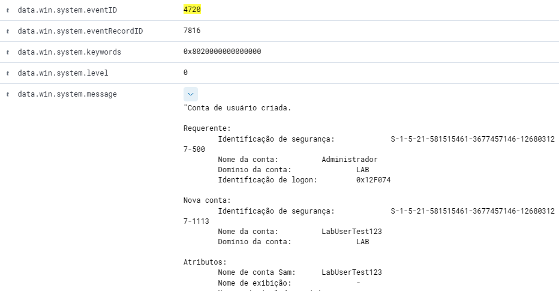
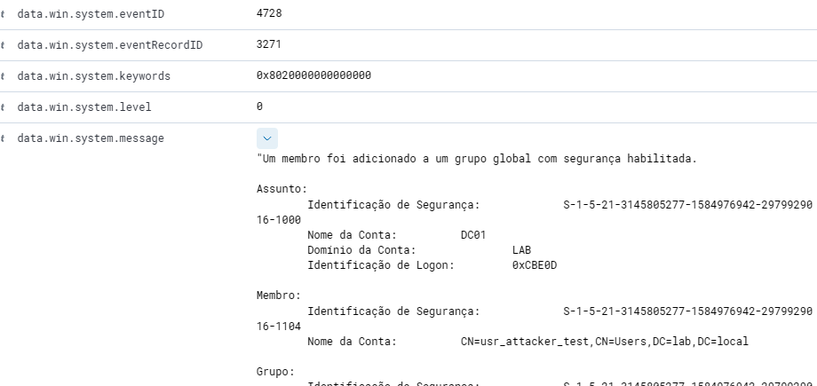

# 04 · Casos de uso de SOC (triagem N1)

Cada ficha segue o formato de playbook: o que ocorreu, o alerta gerado, a análise, a classificação e a ação recomendada.

---

## Caso 1: Falhas de logon repetidas (possível brute force)

| Campo | Detalhe |
|---|---|
| **Como simulei** | Digitei senha incorreta várias vezes para o usuário `teste` no CLIENTE01 |
| **Evento Windows** | 4625 (falha de logon) |
| **Regra Wazuh / severidade** | [_ID Regra 2910 nível 0 a 6_] |
| **Evidências** |  |
| **Análise** | Suspeito. |
| **Classificação** | [Falso positivo / Atividade suspeita / Incidente] |
| **Ação recomendada** | Confirmar com o usuário, verificar logons bem-sucedidos posteriores, bloquear a origem se for externa, forçar troca de senha |

---

## Caso 2: Bloqueio de conta

| Campo | Detalhe |
|---|---|
| **Como simulei** | Excedi o limite de tentativas definido na GPO |
| **Evento Windows** | 4740 |
| **Regra Wazuh / severidade** | Regra 7 a 11  |
| **Evidências** |  |
| **Análise** | Originado do caso 1  |
| **Classificação** | [Tentativa de login repetidamente com senha incorreta] |
| **Ação recomendada** | Validar identidade do usuário, desbloquear e investigar a origem das tentativas |

---

## Caso 3: Criação de usuário

| Campo | Detalhe |
|---|---|
| **Como simulei** | Criei o usuário `LabUserTest123` no DC01 |
| **Evento Windows** | 4720 |
| **Regra Wazuh / severidade** | Regra 7 a 11 |
| **Evidências** |  |
| **Análise** | Administrador criou a conta em um horário suspeito |
| **Classificação** | Benigno, se houvesse solicitação aprovada; suspeito, se fora do processo |
| **Ação recomendada** | Conferir com a área solicitante. Sem justificativa, desativar a conta e escalar |

---

## Caso 4: Inclusão em grupo administrativo (escalada de privilégio)

| Campo | Detalhe |
|---|---|
| **Como simulei** | Adicionei o usuário `usr_attacker_test` ao grupo `[Domain Admins / Administrators]` |
| **Evento Windows** | 4728 (grupo global) / 4732 (grupo local) |
| **Regra Wazuh / severidade** | 12 a 14 |
| **Evidências** |  |
| **Análise** | Quem fez a alteração? O usuário afetado precisa desse acesso? Houve aprovação? |
| **Classificação** | Incidente (Escalada de privilégio) |
| **Ação recomendada** | Mudança sem aprovação: remover do grupo, escalar para N2 como possível incidente |
